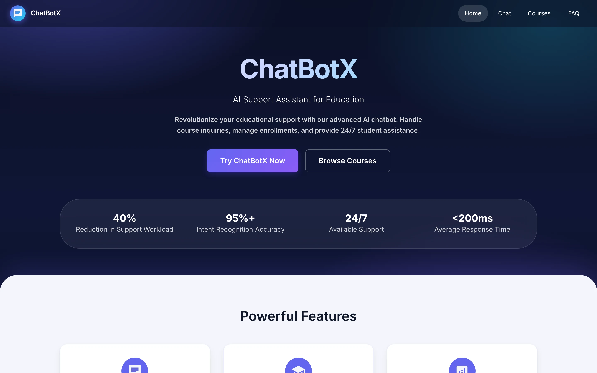
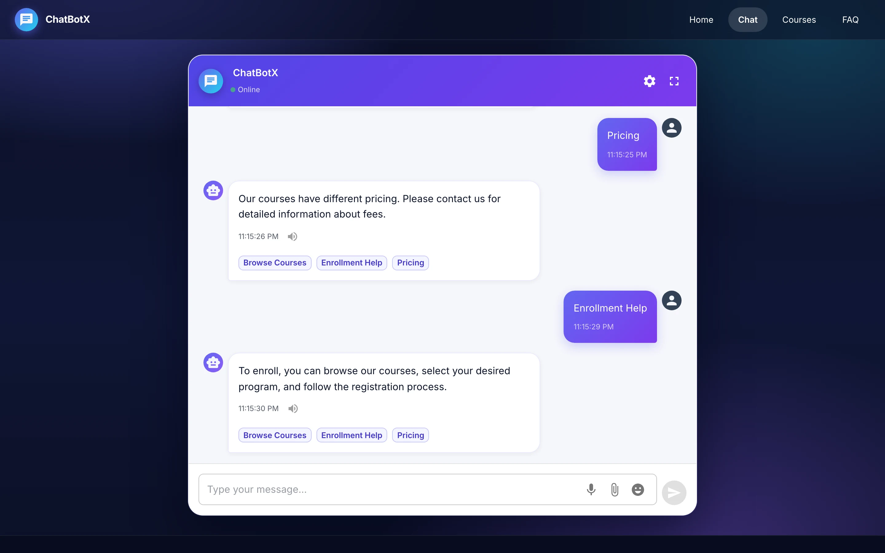
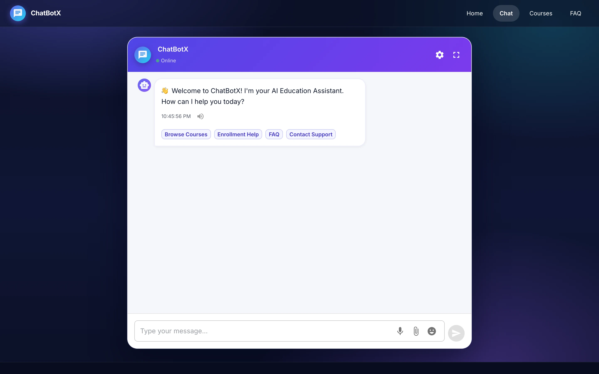
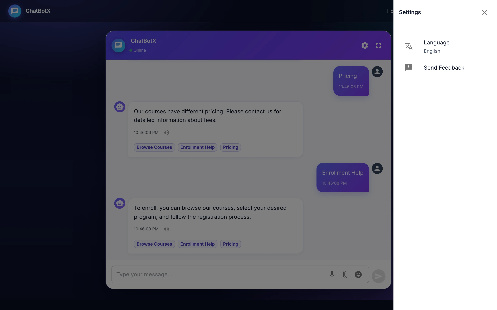
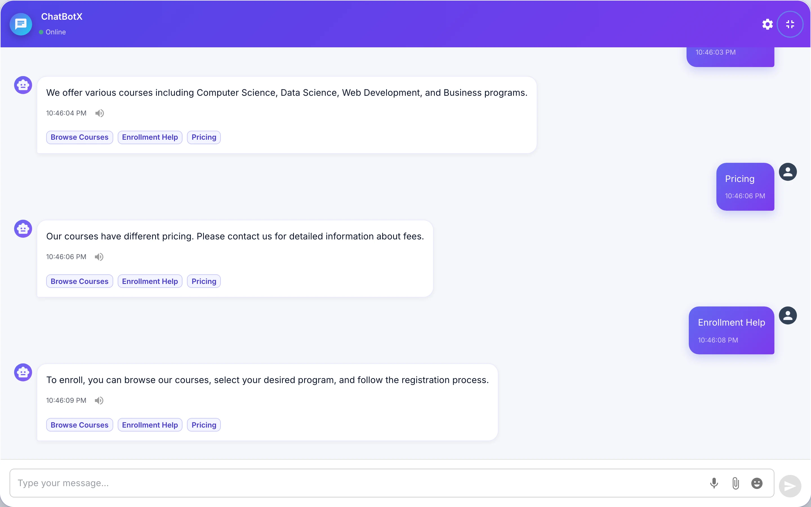
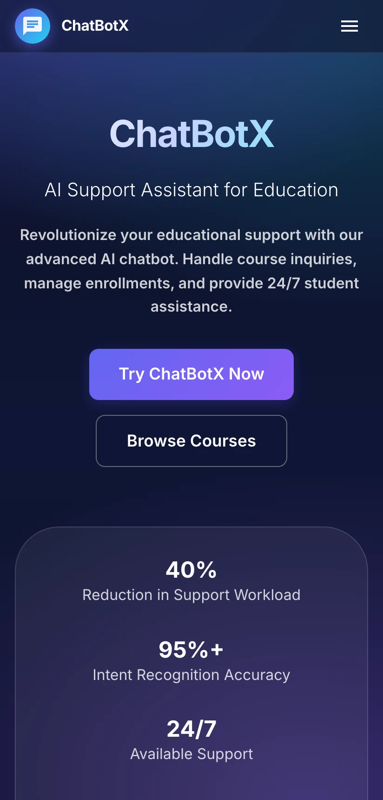
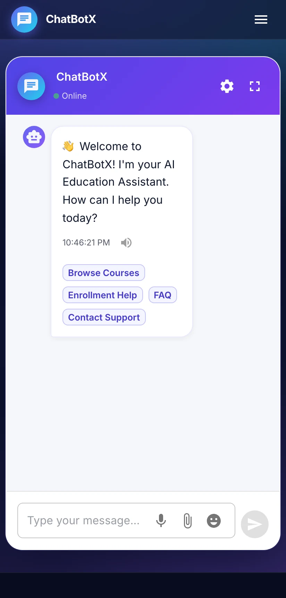

# ChatbotX

**A prototype support assistant for education providers: a responsive landing page and a real-time chat interface with quick replies.**

React · TypeScript · Material UI · Socket.IO · FastAPI

<table>
  <tr>
    <td></td>
    <td></td>
  </tr>
</table>
Screenshots are real captures of a local build running on fictional demo data.

---

## Product at a Glance

| | |
|---|---|
| **What it is** | Landing page and chat UI for an education-support assistant |
| **Chat engine** | Rule-based keyword replies. No LLM and no trained model in the demo |
| **Frontend** | React 18, TypeScript, Material UI 5, Redux Toolkit, Framer Motion |
| **Transport** | Socket.IO (typing and reply events) |
| **Backend** | FastAPI service with keyword matching |
| **Status** | Early prototype. Several sections are placeholders |

## Product Showcase

<table>
  <tr>
    <td> Chat welcome state with quick replies</td>
    <td> Settings drawer</td>
  </tr>
  <tr>
    <td> Full-screen chat</td>
    <td>
      
       Phone-width layouts
    </td>
  </tr>
</table>

## Key Features

- Landing page with hero, feature cards and technology list.
- Chat with message bubbles, typing indicator and quick-reply chips.
- Settings drawer with language selector and feedback entry.
- Full-screen chat mode and responsive layout down to phone width.
- Browser text-to-speech playback of bot replies.
- Socket.IO event flow (`message`, `typing`, `bot_response`).

## Architecture

- React single-page app talks to the backend over Socket.IO.
- The runnable backend is a small FastAPI app answering by keyword rules.
- A thin Socket.IO bridge wraps that app because the original backend exposed only plain WebSocket.
- A fuller backend (MongoDB, Redis, WebSocket manager) and a Rasa 3 project exist in the codebase but were not run.

See [docs/ARCHITECTURE.md](docs/ARCHITECTURE.md).

## Engineering Highlights

- Resolved a client/server transport mismatch with a roughly 30-line bridge, leaving the original backend untouched.
- Reply logic is separated from transport and UI, so the keyword engine can be swapped for an NLU engine.
- Responsive Material UI theme with a custom palette and typography.
- Backend building blocks written for a larger deployment: WebSocket rooms and broadcast, rate-limit and logging middleware, Docker files (read, not run).
- Rasa intent, story and domain files prepared as the intended NLU path (not run).

## Status and Scope

- **Real:** landing page, chat UI, Socket.IO event flow, keyword-based replies, browser speech synthesis.
- **Rule-based:** all replies. There is no AI model, LLM or external API behind the chat.
- **Placeholders:** Courses, Booking, FAQ, Analytics and Admin are "coming soon" cards.
- **Not implemented:** voice input, sentiment analysis, multi-language replies, CRM and calendar integration.
- **Landing copy:** figures such as response time, accuracy, uptime and compliance wording are placeholder marketing text, not measured results.
- The demo runs locally with no accounts and no stored user data.

## Documentation

- [Product Overview](docs/PRODUCT_OVERVIEW.md)
- [Architecture](docs/ARCHITECTURE.md)
- [Technical Case Study](docs/TECHNICAL_CASE_STUDY.md)
- [Engineering Challenges](docs/ENGINEERING_CHALLENGES.md)
- [Privacy and Source](docs/PRIVACY_AND_SOURCE.md)

## Source Code

The source is private and no licence is granted. See [RIGHTS.md](RIGHTS.md).
