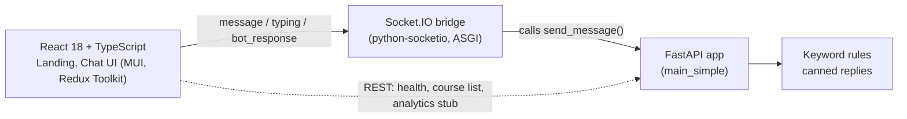

# Architecture

## Demo build

The demo build has no database, cache or NLU engine in the request path.

## Frontend

- React 18, TypeScript, Create React App.
- Material UI 5 for components and theming; Framer Motion for transitions.
- Redux Toolkit store; socket.io-client for the chat transport.
- Routes: `/` (landing) and `/chat` are implemented. `/courses`, `/booking`, `/faq`, `/analytics` and `/admin` render "coming soon" cards.
- Chat features: quick replies, typing indicator, language select, browser speech synthesis for replies, a microphone button that is a stub.

## Backend

- FastAPI service (`main_simple`) with a health endpoint, a few REST routes and a keyword-matching message handler.
- The original service exposes a plain WebSocket and REST only. The frontend expects Socket.IO, so a small bridge (about 30 lines) wraps the unmodified app and emits `typing` and `bot_response` events. It was added only to make the demo run.

## Present in the codebase but not exercised in the demo

- A fuller FastAPI entry point with MongoDB and Redis layers, a WebSocket manager (rooms, broadcast), rate-limit and logging middleware.
- A Rasa 3 project (NLU data, stories, domain) and `rasa_service.py` integration wrapper.
- Dockerfiles and a compose file.

These were read and documented but not run, so their behaviour is not claimed here.
